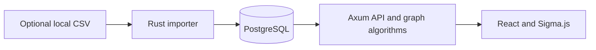

# VentureGraph

VentureGraph explores co-investment relationships between investors. A Rust API and PostgreSQL database provide source-aware network data and graph analysis; a React interface lets users search investors, compare sectors, inspect communities, and trace paths.

The included dataset is fictional demonstration data. It is useful for exploring the application, but it does not describe real investors or funding rounds.

## What it does

- Explore a weighted investor network, where edge weight represents observed shared deals.
- Search and filter investor profiles and inspect co-investment partners.
- Compare sectors and rank investors by PageRank, degree, betweenness, and clustering.
- Find fewest-hop and strongest-connection paths.
- Compare dated event snapshots for the fictional demo dataset.
- Import an optional Fliar aggregate-pair CSV and review its source coverage and licensing.

The community view uses deterministic weighted label propagation. Community labels are heuristic groupings, not verified classifications.

## Run locally

Install current stable Rust, Node.js, npm, and Docker Compose. Start the development stack:

```sh
docker compose up --build
```

Open the app at <http://localhost:15173>. The API is available at <http://localhost:18080>; `/health` checks database readiness. Compose binds published ports to loopback. Its default PostgreSQL password (`venturegraph`) is public and intended only for local development. Set `POSTGRES_PASSWORD` before first startup to use a different local value; changing it for an existing database also requires updating the PostgreSQL role password.

To run the app processes outside Docker, start PostgreSQL, copy `.env.example` to `.env`, then install and start the API:

```sh
pnpm install
cargo run -p venturegraph-api
```

In another terminal:

```sh
pnpm dev
```

The API applies SQLx migrations on startup. The initial migration seeds the fictional demo dataset.

## Try the API

The live demo dataset returns these counts:

```sh
curl http://localhost:18080/api/v1/metrics?dataset=demo
```

```json
{ "dated_rounds": 3, "investors": 8, "relationships": 8 }
```

Find the strongest observed route from Northstar Ventures to Orbit Founders Fund:

```sh
curl 'http://localhost:18080/api/v1/path?from=10000000-0000-4000-8000-000000000001&to=10000000-0000-4000-8000-000000000008&dataset=demo&mode=strongest'
```

The seeded response contains a four-hop route through Commonwealth Seed Fund, Meridian Labs Fund, and Cedar Grove Ventures. Strongest-route cost is the sum of reciprocal shared-deal weights; it is not the fewest-hop route. Full route fields and other endpoints are documented in [the API reference](docs/api.md), with an interactive local page at `/docs` and an OpenAPI schema at `/api/v1/openapi.json`.

## Import a Fliar sample

The importer reads a local CSV in batches and stores source pair observations. Obtain the sample directly from the [Fliar VC Co-Investment Network page](https://fliarbi.com/datasets/investor-coinvestment-network/); it is not bundled with this repository. The free sample is licensed CC BY-NC 4.0 and is restricted to non-commercial use under that license. Its year fields are observation bounds, not exact round dates.

```sh
cargo run -p venturegraph-api --bin venturegraph-import -- /path/to/investor_coinvestment_network_sample.csv
```

Keep source files outside Git. The importer records rejected rows with their CSV row numbers and is idempotent for stable source pair IDs.

## Architecture



```text
apps/web/       React, TypeScript, Vite, and Sigma.js interface
crates/api/     Axum API and CSV importer
crates/graph/   Reusable Rust graph algorithms
migrations/     PostgreSQL schema and fictional demo seed
docs/           API, architecture, data, temporal, and algorithm references
```

See [architecture](docs/architecture.md), [database design](docs/database.md), [graph algorithms](docs/graph-algorithms.md), [temporal semantics](docs/temporal-model.md), and [data sources and licensing](docs/data-sources.md).

## Development checks

```sh
cargo fmt --all --check
cargo clippy --workspace --all-targets -- -D warnings
cargo test --workspace
pnpm typecheck
pnpm lint
pnpm test
pnpm build
```

`make setup`, `make dev`, `make build`, `make test`, `make lint`, and `make import CSV=/path/to/sample.csv` provide shortcuts for common tasks. Contribution guidance is in [CONTRIBUTING.md](CONTRIBUTING.md).

## Scope and limitations

The Fliar dataset provides aggregate pair observations; only fictional demo events support exact event-year comparisons. Portfolio-overlap analysis, authenticated administrative imports, temporal playback, graph caching, rate limiting, browser end-to-end tests, and production deployment configuration are not included. See the [roadmap](ROADMAP.md) for current scope and future work.

## License

VentureGraph source code is licensed under the [MIT License](LICENSE). The optional Fliar sample has separate CC BY-NC 4.0 terms; do not treat it as MIT-licensed project data.
