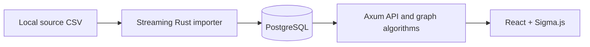

# Architecture

VentureGraph keeps PostgreSQL persistence, Rust graph computations, and the React visualization in separate layers. The API reads source-scoped pair observations and exposes JSON routes. The browser uses Sigma.js/Graphology for rendering and React Query for remote state.

Fictional demo rows and the Fliar sample use separate `data_sources`; the API selects one dataset explicitly. All demo records are fictional. Fliar aggregate pair observations do not provide dated funding-round events. The demo's dated rounds are stored separately from those pair observations.
